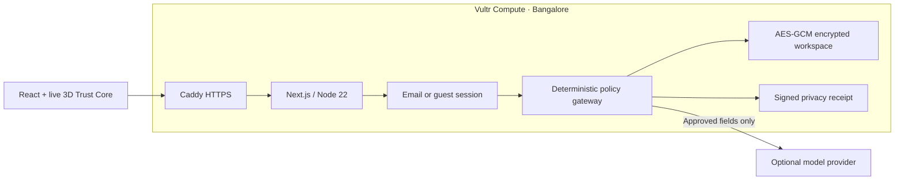

# BORROW

### Your AI. Your rules. Your data.

**[Open the live BORROW application](https://borrow.139-84-216-230.sslip.io)** · Deployed on Vultr Compute in Bangalore.

Use **Try the live demo** for an isolated workspace, or sign in with an email account.

A private AI workspace built around one useful task and one enforceable boundary.

BORROW prepares an October expense report with temporary access to selected invoice fields. When an invoice instructs the agent to read payroll, the server rejects the request. The report finishes, the lease closes, and a signed receipt records what happened.

**HackGlobal release:** email-and-password accounts, isolated guest demo, real server policy enforcement, interactive Three.js visualization, encrypted persistence, and independently verifiable receipts.

[System design](docs/ARCHITECTURE.md) · [Vultr deployment](docs/VULTR_DEPLOYMENT.md) · [Demo script](docs/DEMO_SCRIPT.md) · [Submission package](docs/SUBMISSION.md) · [Live signed evidence](docs/evidence/README.md)

## Run

Requires Node.js 22.13+ and npm.

```sh
npm ci
cp .env.example .env.local
```

Generate a key locally, place it in `.env.local` as `BORROW_MASTER_KEY`, and preserve it across restarts:

```sh
node -e "console.log(require('crypto').randomBytes(32).toString('hex'))"
npm run dev:next
```

Open **http://localhost:3000/login**. Choose **Try the demo** to get a separate synthetic workspace, or create an email account to retain access across browser sign-ins. Passwords require at least 12 characters and use salted scrypt hashing. Email addresses are not verified; password recovery is not implemented in this hackathon release. Use a unique password.

Set `BORROW_ALLOW_LOCAL_DEMO=false` to require the new account/guest sign-in endpoints. The legacy localhost session mode is retained only for development compatibility.

## The interactive story

The homepage and workspace share white surfaces, graphite panels and blue actions. The interactive expense workspace preview leads into four scroll-driven permission chapters, a selectable gateway-decision illustration, and a receipt example. The same Three.js trust core is reused throughout. Native smooth scrolling, keyboard controls, reduced-motion support and off-screen rendering pauses keep the story accessible. Homepage states are clearly illustrative; workspace states come from backend events.

## Three-minute walkthrough

1. Ask: “Prepare my October business expense report.”
2. Review the exact documents, fields, output destinations and expiration in the Intent Capsule.
3. Approve limited access, then start the authorized task.
4. Watch `read payroll-001` fail with `OUTSIDE_APPROVED_SCOPE`.
5. Continue to the **$3,784.50** report. The payment receipt is supporting evidence and is not counted twice.
6. Verify the signed receipt, then run the tamper test.
7. Create a second lease, revoke it, and test invoice access: `LEASE_REVOKED`.
8. Refresh or sign out/back in to confirm persistence.

The attack source and the agent's decision to follow its instruction are scripted for a reproducible demo. The authorization checks, denial, audit chain, signature and verification are real server operations.

## What runs in each mode

| Capability | Default demo | Optional connected mode |
|---|---|---|
| Report processor | Deterministic, labeled | OpenAI report summary via server-only API key |
| Task authorization | Real signed scoped leases | Same gateway; explicit provider destination consent |
| Injection demonstration | Scripted attempted read, real denial | Same repeatable attack; no claim of arbitrary autonomous planning |
| Storage on Node/Vultr | AES-GCM encrypted persistent files | Same; single application replica |
| Receipt | SHA-256 + ECDSA P-256 + event chain | Same; no blockchain anchoring |
| Identity | Email/password or isolated guest | No external identity provider required |
| Google Drive | Not implemented | Credentials alone do not enable it |
| Uploaded documents | .txt/.json, up to 100 KB | Structured USD invoice JSON for October 2026 can enter reports |

For a JSON invoice, use fields such as `vendor`, `invoiceNumber`, `date`, `amount`, `currency`, `category` and `description`. Plain text can be privately previewed; generic OCR/PDF extraction is not implemented.

## Architecture



The frontend and backend run on Vultr Compute behind Caddy HTTPS. Public workflow and account/upload checks pass, including a container-recreation test that preserves accounts, reports and signing keys. See [deployment instructions](docs/VULTR_DEPLOYMENT.md) and the [validation record](docs/VALIDATION.md).

## Verify

```sh
npm run typecheck
npm test
npm run build:next
# With the local or deployed app running:
node scripts/smoke.mjs http://localhost:3000
# Production server, with secure cookies and legacy local auth disabled:
node scripts/release-check.mjs https://your-public-hostname
```

Security tests cover allowed/denied reads, lease expiry/revocation, tenant isolation, field/operation/destination limits, lease forgery, prompt injection, receipt integrity/tampering, provider disclosure, revocation during inference and account/session behavior. The HTTP smoke test traverses all app pages and the complete report workflow using an isolated guest.

Download a receipt and verify it without running the application:

```sh
node scripts/verify-receipt.mjs receipt.json
node scripts/verify-receipt.mjs receipt.json --expected-key public-key.json
```

Without an independently trusted public key, verification establishes consistency with the included key, not the signing operator's identity.

## Deploy on Vultr

The repository includes a non-root multi-stage Docker image and Caddy TLS reverse proxy. The Next.js backend and frontend run on the Compute instance; its encrypted data lives in a persistent Docker volume.

```sh
cp .env.example .env.production
# Set a real BORROW_MASTER_KEY; do not commit this file.
export APP_DOMAIN=borrow.your-domain.example
docker compose --env-file .env.production -f deploy/compose.yaml up -d --build
```

Point the hostname at the instance, open 80/443 and restrict SSH to your IP. See [VULTR_DEPLOYMENT.md](docs/VULTR_DEPLOYMENT.md) for provisioning prerequisites, backups and verification. `/api/health` reports service status without exposing private records.

## Project map

- `app/` — App Router pages, account and workspace API routes
- `components/` — professional interface and reusable `TrustCore3D`
- `lib/server/` — accounts, scoped authorization, encrypted storage, report execution, signed receipts
- `tests/` — security and account regressions
- `deploy/` — Vultr Compute Docker Compose and HTTPS proxy
- `docs/` — architecture, judging walkthrough and submission checklist
- `scripts/verify-receipt.mjs` — standalone offline verifier
- `worker/`, `db/`, `drizzle/` — separate legacy Sites/D1 deployment support

## Honest limits

- A deliberately narrow hackathon workflow, not a general agent sandbox or security certification.
- No email verification, recovery flow, distributed rate limiter, key-rotation workflow or production backup service.
- Encrypted at rest; the server and approved model provider process plaintext. This is not end-to-end encryption.
- Revocation prevents subsequent authorized operations and report publication; it cannot recall fields already sent to a provider.
- The event stream is logically append-only, but an operator controls storage and signing keys. No external transparency witness or on-chain anchor exists.
- Receipts do not prove source-document truth, exhaustive monitoring or prevention of all leaks.
- Keep a single Node replica with the current file adapter. Multiple replicas require transactional shared storage.
- Real user interviews, geographic reach, final Vultr deployment and the on-Vultr recording must be evidenced before submission.
