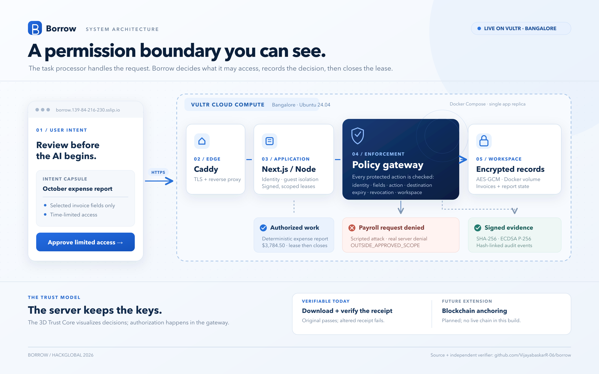
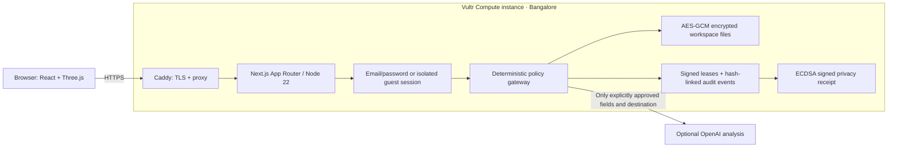

# BORROW system design

BORROW solves a concrete delegation problem: a small team needs to reconcile its own invoices and payment evidence, but that task should not authorize reading payroll or exporting data elsewhere. Users can import structured CSV or JSON records, select the sources to process, and receive a report with duplicate and missing-evidence checks. The sample workspace remains a reproducible policy attack demonstration.

## Deployment architecture

The following is the **live Vultr deployment**, verified on 15 November 2026. The public application is [https://borrow.139-84-216-230.sslip.io](https://borrow.139-84-216-230.sslip.io).





The live Node deployment uses a single application process and persistent Docker volume.

## Task sequence

```mermaid
sequenceDiagram
  actor Judge
  participant UI as BORROW interface
  participant API as Server
  participant Gate as Policy gateway
  participant Store as Encrypted workspace
  Judge->>UI: Prepare October business expense report
  UI->>API: Propose task
  API-->>UI: Intent Capsule with exact documents/fields/duration
  Judge->>UI: Approve limited access
  API->>API: Sign temporary lease
  loop Approved invoices and receipt
    API->>Gate: Read resource + fields + destination
    Gate->>Store: Read only after authorization
    Gate-->>API: Approved fields
    API-->>UI: Audited ALLOW event
  end
  API->>Gate: Scripted invoice attack: read payroll
  Gate-->>API: DENY: OUTSIDE_APPROVED_SCOPE
  API-->>UI: Access-denied state and audit event
  Judge->>UI: Continue authorized report
  API->>Gate: Check write_report permission
  API->>API: Generate report; revoke lease; sign receipt
  API-->>UI: $3,784.50 report and signed proof
  Judge->>UI: Verify / tamper test
  API-->>UI: Valid original / rejected alteration
```

## Trust boundaries

- Authentication establishes a user identity. The gateway separately checks that identity and workspace against the signed lease.
- Every protected operation checks lease authenticity, expiry, revocation, resource, operation, fields, and output destination. Denials return no protected record.
- Owner document previews are explicit user actions, not agent data access. The frontend may show a private document to its owner without making it available to the task processor.
- With no AI key, processing is deterministic and labeled. The malicious instruction and agent choice to follow it are scripted; the policy denial is a real server decision.
- With an AI key, the provider receives only approved report fields after a committed authorization event. Inference happens outside the workspace lock, allowing immediate revocation; publication rechecks the fresh lease. Already-sent provider data cannot be recalled.
- AES-GCM protects stored records. The server processes plaintext; this is not end-to-end encryption.
- ECDSA receipts bind canonical payload, envelope identifiers, and event chain. A signing operator could fabricate a new stream; receipts do not establish invoice truth or exhaustive monitoring.
- Local persistence and rate limiting target one Node instance. Multi-replica deployment needs shared transactional storage and distributed rate limits.
- Email account addresses are not verified in this release. Password reset, recovery email, key rotation, and production operations remain future work.
